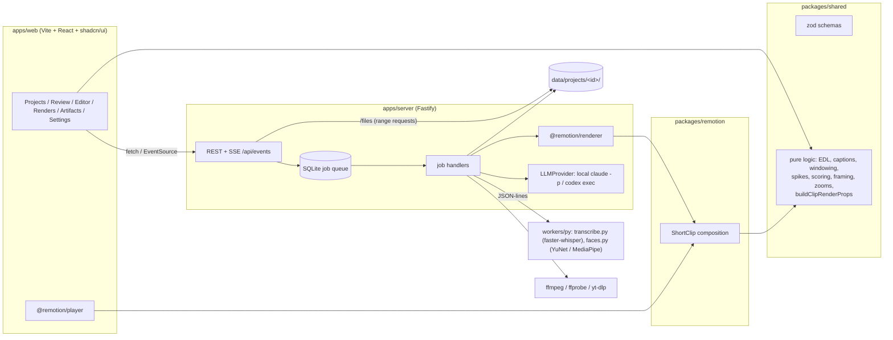

# 🎬 ClipForge


A local vibe-coded complete clipping system for turning long-form video into
short form clips for Youtube Shorts, TikTok, Instagram Reels, etc. It features
AI powered analysis of the video, that select the best moments, a clip oriented
editor with live preview, and a render pipeline that produces a final mp4 with
captions, hooks, framing and zooms.

By design it is a local system that uses your local codex or claude code for analysis,
as well as OpenAI's Whisper for transcription. Can be a little slow with just the CPU
for long videos, but the GPU requirements are low, for me it runs well on a
RTX 5060 8GB.

## 📦 Requirements

| | |
|---|---|
| **Node.js** ≥ 22 and **pnpm** 10 | `setup.sh` installs pnpm to `~/.local` if it is missing |
| **ffmpeg / ffprobe** | required. NVENC (`h264_nvenc`) is used for proxies and pre-cuts when it works, with `libx264` as the fallback |
| **Python** ≥ 3.11 | for the ML workers (faster-whisper, MediaPipe/OpenCV). 3.12–3.14 tested |
| NVIDIA GPU + driver | optional. Transcription falls back to CPU automatically |
| **yt-dlp** | optional, only needed for YouTube / Twitch URL import (and the "most replayed" heatmap) |
| `claude` or `codex` CLI | optional, logged in. Used for LLM ranking, hooks and metadata |
| Internet on first render | Remotion downloads Chrome Headless Shell once; Google Fonts load at render time |

## 🚀 Setup & run

```fish
./setup.sh      # checks ffmpeg/yt-dlp/CUDA, pnpm install, Python venv, face models, creates .env
pnpm dev        # server on :5174, web UI on http://localhost:5173
```

Other commands:

```fish
pnpm test       # unit tests (shared logic + server LLM layer)
pnpm test:e2e   # end-to-end: synthetic video → pipeline → rendered mp4 (~1 min)
pnpm typecheck
pnpm lint
pnpm build && pnpm --filter @clipforge/server start   # serve the built UI from the server on :5174
```

## ⚙️ Configuration (`.env`)

| Variable | Default | |
|---|---|---|
| `PORT` | `5174` | API server port (the Vite dev server proxies `/api` and `/files` to it) |
| `DATA_DIR` | `./data` | SQLite DB + `projects/<id>/` folders + `music/` |
| `FFMPEG_PATH`, `FFPROBE_PATH`, `YTDLP_PATH` | from `PATH` | |
| `PYTHON_PATH` | `workers/py/.venv/bin/python` | |
| `JOB_CONCURRENCY` | `{"transcribe":1,"proxy":2,"render":1,"faces":1,…}` | JSON, merged with the defaults |
| `WHISPER_MODEL_GPU` | `large-v3-turbo` | |
| `WHISPER_MODEL_CPU` | `small.en` | used when CUDA is unavailable or fails |
| `WHISPER_DEVICE` | `auto` | `auto` \| `cuda` \| `cpu` |
| `FACE_DETECTOR` | `auto` | `auto` (YuNet, then MediaPipe as fallback) \| `yunet` \| `mediapipe` |
| `LLM_PROVIDER` | `none` | `none` \| `claude` \| `codex`: local CLI agents using your existing login (no API keys). This is only the default; switch at runtime from the header or Settings |
| `CLAUDE_PATH`, `CLAUDE_MODEL` | `claude`, CLI default | e.g. `CLAUDE_MODEL=sonnet` |
| `CODEX_PATH`, `CODEX_MODEL` | `codex`, CLI default | |
| `LLM_TIMEOUT_MS` | `300000` | per CLI call |

With no LLM, everything still works: ranking uses the heuristic score and metadata/hooks come from templates.

**Switching Claude Code ⇄ Codex.** Use the LLM menu in the header, or Settings → LLM. Settings also has per-CLI model fields and a "Test" button that does a round trip through the CLI. The choice is stored in the database and applies to the next LLM call; running jobs keep the CLI they started with.

**Clip boundaries.** Candidates always start at the beginning of a sentence and end at the end of one. Sentences are found from Whisper's punctuation and pauses; in stretches where Whisper dropped punctuation, a capitalised word (other than "I") also starts a sentence. Very long sentences are split into clauses, and windows widen to full sentences when the length limit allows. When the LLM ranks candidates it doesn't guess seconds. It sees each candidate's transcript as numbered sentence and clause pieces, with timestamps, start/end-of-sentence markers and a little context outside the range, and it answers with piece ids. Those map exactly to word boundaries.

**How the LLM is called.** No API is used. Each request runs the CLI you already use, in an empty temporary directory, with your existing login:

- **claude:** `claude -p --output-format json --json-schema <schema> --tools "" --setting-sources "" --no-session-persistence`, with the prompt on stdin. Tools are off, your hooks/plugins/settings are not loaded, and no session is saved.
- **codex:** `codex exec --ephemeral --sandbox read-only --skip-git-repo-check --output-schema <file> -o <file> -`

`ANTHROPIC_API_KEY`, `ANTHROPIC_AUTH_TOKEN`, `OPENAI_API_KEY` and `CODEX_API_KEY` are stripped from the child environment so the login is always used. Every answer is validated with zod and retried once on invalid output. If the CLI fails, ranking falls back to heuristics and is logged in the job.

## 💮 Workflow

1. **Projects:** drag a file in (chunked and resumable; after a reload use "Resume upload" with the same file) or paste a YouTube or Twitch VOD URL.
2. **Pipeline** (automatic, every step cached in the project folder): probe → 720p proxy → audio (16 kHz WAV + 48 kHz FLAC) → transcription with word timestamps → loudness (ebur128), energy curve, spikes, silences → scene cuts → heatmap (YouTube imports) → Twitch chat replay (Twitch VOD imports) → audio signals → visual signals → candidate windows → ranking.

   **Audio signals** (`workers/py/signals.py`, after transcription, ~30 s per hour of audio on a GPU): AudioSet tags from the [Audio Spectrogram Transformer](https://huggingface.co/MIT/ast-finetuned-audioset-10-10-0.4593) (laughter, cheering/applause, shouting/screaming, gasps, singing, music), voice arousal from [audeering's wav2vec2 emotion model](https://huggingface.co/audeering/wav2vec2-large-robust-12-ft-emotion-msp-dim) (CC BY-NC-SA, non-commercial), pitch (YIN) and vocal effort (spectral balance). **Visual signals** (`workers/py/visual.py`, parallel with transcription, ~1.5 min per hour of video): a frame-difference motion curve and an [X-CLIP](https://huggingface.co/microsoft/xclip-base-patch32) zero-shot "dancing / performance" score from one 4 fps NVDEC decode. Both are optional: if a model can't run, candidates are found without it.

   **Scoring.** Each signal is normalized against the video itself (and voice features against the speaker's own baseline), so "loud" or "excited" means unusual *for this video*. Highlight signals (energy, chat, heatmap, laughter, cheering, vocal intensity, pitch, dance) are combined with a power mean (Settings → *Peak emphasis*, default 3): one huge laugh is no longer averaged away by quiet signals, and a signal that's absent weighs less than one that's present. Peaks of the laughter / cheering / excitement / dance tracks seed candidate windows, dancing with little speech gets plain time windows, and music with dancing or laughter isn't penalized as filler. The LLM sees the detected events as tags (`[laughter]`, `[cheering/shouting]`, `[dancing/singing]`) when nominating and ranking. The review timeline shows them as a four-row lane. Settings → Heuristic weights → *Suggest weights* fits the weights to your approve/reject decisions (approved vs. rejected, and candidates you skipped while approving lower-ranked ones).
3. **Review page:** proxy player plus a multi-track timeline (energy, spikes, heatmap, Twitch chat activity, silences, scene cuts, word density, candidates coloured by rating). Click a card to loop it. Drag the handles to trim (snaps to words; hold <kbd>Shift</kbd> to turn snapping off). Drag in the bottom lane to make a manual selection, then click "Create candidate". Keyboard: <kbd>Space</kbd>, <kbd>J</kbd>/<kbd>K</kbd>/<kbd>L</kbd>, <kbd>I</kbd>/<kbd>O</kbd>, <kbd>A</kbd> approve, <kbd>X</kbd> reject, <kbd>↑</kbd>/<kbd>↓</kbd>.
4. **Editor** (opened from an approved clip): the live `@remotion/player` preview uses the same composition and the same props builder as the renderer. Tabs: cuts (dead air, fillers, struck words, restorable cuts, speed), captions (presets, fonts, per-word text fixes), hook (with 5 suggestions), framing (face-track / centre / manual keyframes / split / blur-fill), zoom, look, extras & output, publish (metadata). Undo/redo with <kbd>Ctrl+Z</kbd> / <kbd>Ctrl+Shift+Z</kbd>; changes autosave.
5. **Renders:** queue one clip or batch-render a whole project. Output goes to `data/projects/<id>/renders/<name>_<clipId>.mp4` with `.json` and `.txt` metadata next to it, and is optionally copied to the export directory set in Settings.
6. **Artifacts:** every rendered `.mp4` found on disk under `data/projects/*/renders/`, newest first, as a grid of 9:16 players (one plays at a time). Filter by project or search titles; download, open the folder, or jump to the clip's editor.
7. **Hook duration:** the Hook tab has "Keep the hook on screen for the whole video". The hook then stays until the last frame with no fade-out, and your normal duration is kept for when you switch it off. Batch render can set this for every clip: Hook → whole video / normal duration / keep.
8. **Emojis:** a clip can have a **hook emoji** (one emoji before or after the hook text) and **caption emojis** (shown above the caption lines that deserve one). **"At most one emoji every N s"** (Captions tab or the Emoji menu) sets the frequency. The LLM receives it as a budget and minimum spacing, and the preview/render enforce it too, so lowering the frequency applies instantly. To get *more* emojis, re-pick with the LLM. Turn them on in three places:
   - the **Emoji** menu next to Render in the editor,
   - the Hook and Captions tabs,
   - for a whole batch: Renders → Batch render → Hook emoji / Caption emojis (keep / on / off).

   Missing picks are chosen by the LLM in a pre-render step. You can also pick now to review: remove individual caption emojis, type your own hook emoji, or re-pick. With the LLM off, keyword matching is used instead.
9. **Twitch chat:** for Twitch VOD imports the chat replay is downloaded alongside the video (public endpoint, no login; ~16 requests/s, about 10 min for a 12 h VOD with very busy chat). Chat activity per second combines the unique-chatter rate and *emote waves* (most of chat posting the same "W" / "KEKW", which still shows in slow-mode chats whose rate stays flat), relative to the stream's own baseline, boosted by laughter/hype and shifted back ~4 s for chat delay. Peaks seed candidate windows, "Chat activity" is a scoring feature (weight in Settings), and the LLM ranking prompt gets what chat said during each candidate. Expired, deleted or sub-only VODs have no chat.

## 🤔 Architecture



- **One source of truth for rendering.** `buildClipRenderProps()` in `packages/shared` turns the clip range, `EditConfig`, transcript, analysis and face samples into `ClipRenderProps`: the EDL of kept segments, re-timed caption pages, the framing track, zoom keyframes and so on. The editor preview and the server render both call it, so what you see in the preview is what gets rendered.
- **Render path:** ffmpeg pre-cuts the clip range (±1 s) with frequent keyframes, so Remotion never seeks through a multi-GB source. For blur-fill framing it also makes a tiny pre-blurred copy for the background, so Chrome never blurs a second full-resolution video. Remotion `renderMedia` then renders at 1080×1920 (x264 high, CRF 18) with headless Chrome drawing on the GPU (`REMOTION_GL=angle`, 3 tabs; it falls back to CPU rendering if the GPU backend fails). Video frames are decoded in the browser with `@remotion/media`'s `<Video>` (WebCodecs) rather than `<OffthreadVideo>`, which hands Chrome an uncompressed image per frame and keeps the GPU idle. A two-pass `loudnorm` to −14 LUFS follows, with the video stream copied, AAC 192k and `+faststart`.
- **Jobs** are rows in SQLite with status, progress, log and dependencies, and per-type concurrency. A job that was running when the server died is marked failed with a retry button. Failed steps can also be skipped from the UI so the rest of the pipeline continues.
- **Heavy JS work** (candidate scoring over multi-hour transcripts) runs in a worker thread. Media and ML work runs in subprocesses with timeouts and abort support, and their stderr goes into the job log.

### Project folder

```
data/projects/<id>/
  source.mp4            proxy.mp4         thumb.jpg
  audio16k.wav          audio48k.flac
  transcript.json       audio_analysis.json   scenes.json   heatmap.json   source.info.json
  chat_messages.json    chat.json        (Twitch VODs: raw replay + activity)
  candidates_pool_<batch>.json
  faces/<start>-<end>-e<N>.json
  renders/<name>_<clipId>.mp4 (.json, .txt)    renders/work/<clipId>/precut.mp4
```

## 🗒️ Notes, limits and deviations from the spec

- **Uploads** are chunked `PUT` requests of raw bytes streamed to disk at an offset, rather than multipart. This makes them resumable and keeps memory flat for multi-GB files.
- **Transcription** uses faster-whisper rather than WhisperX: word timestamps are good enough and it avoids a torch dependency. The WAV is fed in as a numpy array, which sidesteps PyAV API changes. When CUDA fails (cuDNN or kernel issues on new GPUs), the worker logs it and retries on CPU with `WHISPER_MODEL_CPU`.
- **Face tracking** always uses face detection and never crops into empty space:
  - Detection runs automatically when a clip is approved, when its range or framing settings change, when the editor opens on a clip without face data, and before rendering.
  - The default detector is OpenCV YuNet. It finds faces down to about 4% of the frame width, i.e. people in a wide two-person shot. MediaPipe's short-range model misses faces narrower than about 10% of the frame and is only the fallback.
  - The camera starts on the first face in the clip, holds the last framed person through dropouts, and snaps to the first face after a scene cut.
  - If no face is known (detection still running, or none found), the clip shows the full frame with blur fill instead of a blind centre crop. The editor's Framing tab says which case applies.
  - Tracks are smoothed in TypeScript (`packages/shared/src/logic/framing.ts`): identities persist across frames and reset on scene cuts, a new dominant speaker only takes over after `switchMinSec` and the camera eases to them, short dropouts are held, and the camera follows a critically damped spring.
- **J/K/L:** browsers can't play video in reverse, so <kbd>J</kbd> jumps back 5 s instead of playing backwards.
- **Remotion** licensing: free for individuals and small teams; see remotion.dev/license.

## 🦍 Troubleshooting

- **"Python venv not found"**: run `./setup.sh`. You can also point `PYTHON_PATH` at another interpreter that has `workers/py/requirements.txt` installed.
- **Transcription is slow**: check the transcribe job log for `on cuda`. If it fell back to CPU, the log shows why. `nvidia-smi` must work, and the venv's `nvidia-cublas-cu12` / `nvidia-cudnn-cu12` libraries are put on `LD_LIBRARY_PATH` automatically.
- **No candidates**: open the Pipeline sheet on the review page. A failed step can be retried, or skipped so ranking continues with less data.
- **First render hangs at the start**: Remotion is downloading Chrome Headless Shell and bundling the composition. This happens once per server start or install.
- **Clip shows the full frame (blur fill) instead of a crop**: no faces were found. The Framing tab shows how many samples had faces. Use manual keyframes to place the crop yourself.
- **Jobs marked "Interrupted by server restart"**: in `pnpm dev` the server restarts when its source files change. Retry the job.
